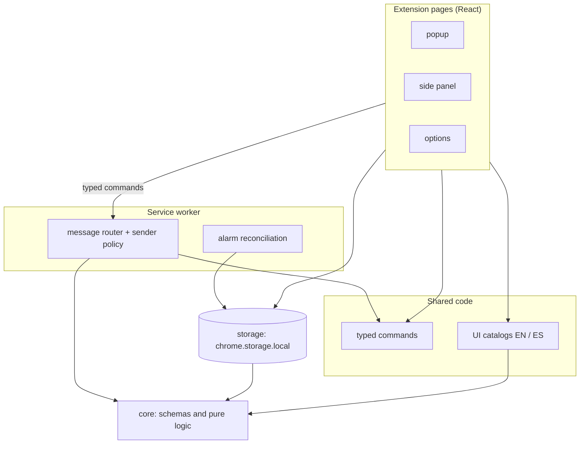

# Architecture

The extension is a Manifest V3 shell around a functional core. Dependencies point inward: UI and worker code depend on the core, never the other way round, and the layer rules are enforced by dependency-cruiser in CI.

## Layers

| Layer | Responsibility |
|---|---|
| `src/core` | Schemas and pure logic. No browser globals. |
| `src/storage` | Typed access to extension storage. |
| `src/shared` | Typed commands shared by pages and the worker. |
| `src/background` | Message router, sender policy, alarm reconciliation. |
| `src/ui` | React components and the English and Spanish catalogs. |
| `src/entrypoints` | Thin wiring for WXT; never imported by other code. |

## Message flow

Pages send Zod-validated commands to the service worker. The router rejects messages from other extensions, from web pages, and from any extension page that is not the popup, side panel or options page.

This document is updated whenever the shape of the system changes.
